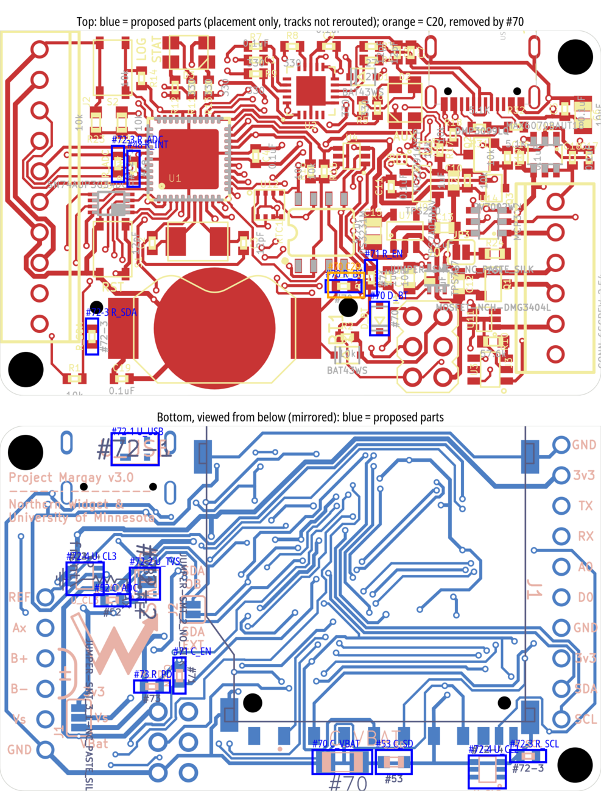
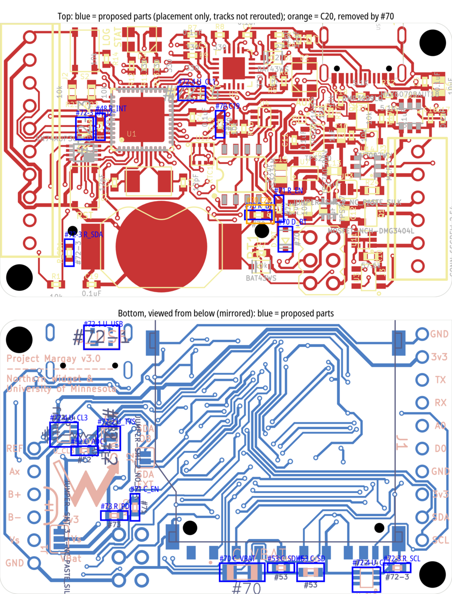

# Margay v3.1: room for the parts six issues add

Board: Project-Margay `Hardware/KiCAD/Margay.kicad_pcb` at ca24e31 (2026-11-12), 50.2 x 30.5 mm. The outline stays (Andy, 2026-11-10). Placement only: nothing here is routed, and Andy does the layout. This study tells him where each part can go and what it displaces.

## Two facts that change the plan

1. **The bottom is already an assembly side.** J1, the SD holder, is an SMT part on B (with JP1, JP2 and LOGO1). Bottom-side passives therefore add parts to an existing side and need no new process. The bottom outside J1 is a strip about 16 mm wide at the J3 end (x 157.7 to 173.6) and a strip 3.5 mm tall along the long edge (J1's pad row ends at y 116.37, the edge is at 120.23, less the 0.4 mm keepout).
2. **#48's pull-up belongs on 3V3, not on 3V3_AUX as the issue proposes.** `Margay::turnOffSDcard()` turns 3V3_AUX off before every sleep (`powerAux(OFF)`), and the clock's alarm on RTC_INT is what wakes the logger. A 10 kΩ to a rail at 0 V would hold RTC_INT low through the whole sleep, against PB2's internal pull-up to 3V3 (`pinMode(RTCInt, INPUT_PULLUP)`, NW_Logger.cpp:140). Pin 38 of U1 (3V3) sits beside pin 42 (RTC_INT), so the pull-up goes at the ATmega end.

## Result

Conservative case: footprints without a courtyard (34 of 84, from the Eagle import) block their whole outline drawing. Placements are greedy, in the order below, each part blocking the next.

| Issue | Part | Package | Fits, with a reroute | Fits as routed today | Where (conservative case) | Tracks to move |
|---|---|---|---|---|---|---|
| #70 | 100 µF at VBAT | 1206 | yes, bottom | no | under BT1's edge, between J1's pad row and the board edge, 0.8 mm from the target | 3V3_AUX, MISO |
| #70 | BAT43WS, cell to VBAT | SOD-323 | yes, top | yes | 5.8 mm from BT1+ | – |
| #70 | 1 kΩ, cell to VBAT | 0402 | yes, top | no | in C20's place | – (own nets) |
| #71 | 10 kΩ, PC6 to EN | 0402 | yes, top | no | 4.1 mm from U7 pin 3 | PG, RST |
| #71 | 0.1 µF, EN to GND | 0402 | yes, bottom | no | under U7, 1.2 mm | VSWITCH_CTRL, a 3V3 via |
| #73 | 100 kΩ, EN to GND | 0402 | yes, bottom | no | 3.1 mm | VMAIN, 3V3 |
| #48 | 10 kΩ pull-up, RTC_INT | 0402 | yes, top | no | beside U1 pins 38 and 42 | SD_CD, GPIO_EXT_D0, TX_EXT, vias |
| #52 | 0.1 µF at U14 VDD | 0402 | yes, bottom | no | under U14, 1.4 mm | SCL, two vias |
| #53 | 4.7 µF at J1 VDD | 0603 | yes, bottom | no | 2.8 mm from J1 pin 4 | – (GND) |
| #53 | 0.1 µF at J1 VDD | 0402 | no | yes, before the 100 µF takes its spot | – | – |
| #72-1 | USB array (SP0503BAHTG) | SOT-143 | yes, bottom | **yes** | behind J4, 3.1 mm | none |
| #72-2 | TVS0500, VBAT+ | WSON-6 (DRV) | yes, bottom | no | 5.7 mm from Q1 | 3V3, SCL, SDA_OB |
| #72-3 | 330 Ω, TX RX ADC GPIO | 4 x 0402 array | yes, top | no | between J2 and U1 | (ESTIMATE footprint) |
| #72-3 | 330 Ω, SDA | 0402 | yes, top | yes | 3.9 mm from J2 pin 9 | – |
| #72-3 | 330 Ω, SCL | 0402 | yes, bottom | yes | 3.1 mm from J2 pin 10 | – |
| #72-4 | clamp, TX RX ADC GPIO | SC-70-6 | **no**, nowhere within 10 mm | no | – | – |
| #72-4 | clamp, SDA SCL | SC-70-6 | yes, bottom | no | below J1's pad row | – (GND) |
| #72-4 | clamp, AX VREF | SC-70-6 | yes, bottom | no | 3.0 mm from J3 | 3V3, 3V3_AUX, VREF, VUSB |

C20 (1 µF, 0603) comes off the board with #70.

In short: every addition from #70, #71, #73, #48, #52 and #53 fits, the 0.1 µF at the SD card excepted, if Andy moves tracks, and about half of them go on the bottom. #72 fits through its priority 3 once the four J2 resistors become one array. Its priority 4 fits at J3 and on SDA/SCL, and not on the four J2 signal lines. Only four parts fit as routed today (the USB array, the diode, and the SDA and SCL resistors).

## Sensitivity

A second case gives parts without a courtyard their pads plus 0.25 mm (an estimate of the IPC courtyard), and frees the bottom's "Project Margay v3.0" text and LOGO1 to move. Every verdict above is the same, except that the 100 µF then also fits on top, 8.3 mm from the target, and several parts sit closer to their pins (`runs_final.txt`).

## Checks

- KiCad's DRC on a scratch board with every placement (`build.py`): 0 courtyard overlaps involving a new part, the same 2 courtyard overlaps as the unchanged board (C10, left for the layout pass), and no edge-clearance violation. The clearance and shorting items it reports are the tracks listed above.
- That DRC found an error in the first pass: J1's pads stop 0.4 mm outside its courtyard (pad row to y 116.37, courtyard to 115.97), and three bottom placements landed on them. Existing pads now block in every mode. **J1's courtyard in nw-cold-silicon (SD_WURTH_WR-CRD) should enclose its pads.**

## Method

`tools/margay-room31/`: `occ.py` builds the occupancy grid at 0.1 mm per side (courtyards with 0.15 mm spacing, through-hole pads on both sides, board-level silkscreen, 0.4 mm edge, since the board asks 0.381 mm copper to edge). `place31.py <cu|crt> FB` searches each part, top first, then the bottom, at 0° and 90°, nearest to its target. Mode `cu` also keeps new pads 0.15 mm clear of every existing track, via and pad. Mode `crt` keeps them clear of pads only. Targets and radii are in `parts2.json` (the J2 resistors and the RTC_INT pull-up target the ATmega pins, and the 100 µF anywhere along VBAT). `parts3.json` replaces the four J2 resistors with the array, whose footprint in `scratch.pretty` is an estimate (4 x 0402 convex, 2.4 x 1.9 mm courtyard).

Reproduce: copy the board from ca24e31 to `Margay.kicad_pcb` beside the scripts, then run `PARTS=parts2.json python3 place31.py crt FB`.

## Completion pass (2026-11-12): a place for every part

The plan is `tools/margay-room31/placed_parts4D.json` (`PARTS=parts4D.json python3 place31.py crt FB`). It places all 19 parts, and KiCad's DRC on the scratch board reports no courtyard overlap with any of them (only the 2 at C10 that the board already has). Three changes from the first pass:

1. **The 0.1 µF at the SD card now fits**, 1.7 mm from J1 pin 4 on the bottom, by placing it before the 100 µF. The 100 µF moves 1.9 mm along VBAT and stays on the bottom.
2. **C19 moves to the clock**, as #70 asks: on top, 4.1 mm from RTC1 pin 6. Today it sits 23 mm away at BT1's far spring.
3. **The J2 signal-line clamp sits behind the resistor array, at the ATmega**, which is the order #72 asks for. Neither end of the J2 lines has room beside it: a single-line 0402-size TVS fits near U1 pins 11 and 12 (TX, RX) and not within 6 mm of pins 37 and 43 (ADC, GPIO). A 4-line clamp fits on top 7–8 mm from U1, in USON-10 (`placed_parts4D.json`) or SC-70-6 (`placed_parts4E.json`). ADC and GPIO then run around U1 to reach it, and that routing is not tested.

Still open before the plan is a layout:
- Part choices for #72: the USB array, the clamp parts, and a 4 x 0402 resistor array. The array and USON-10 footprints here are estimates, and none of the three is in nw-cold-silicon yet.
- #73's value (100 kΩ or 1 MΩ), and #48 on 3V3 rather than 3V3_AUX.
- Moving the tracks listed above. That is Andy's layout pass, and the study does not show that every reroute closes.
- J1's courtyard in nw-cold-silicon, which stops 0.4 mm short of its pads.

## Which existing parts could move to the bottom

J1 covers the bottom from x 128.3 to 157.7 and y 89.1 to 116.4, so no top part above it can flip: 47 of the 79 top footprints sit there, including U1, J2, RTC1, BT1, U7 and everything around them. That is the crowded half, where the J2 clamp and resistors and the RTC_INT pull-up compete for room, and flipping cannot help it.

The other 32 sit clear of J1, at the J3 and USB end and along the lower edge: C5, C6, C10, C12, C13 and C16–C19, R1, R17–R19, R21, R31 and R32, Q1–Q3, U3, U6, U10, U11, U13 and U14, plus R10 and R24 (0603). These could move to the bottom. The new parts at that end (#52, #71, #73, the TVS and the J3 clamp) already have bottom spots, so flipping an existing part there trades places rather than adding room. It earns its place where a new part should sit on top beside its pin, such as #52's capacitor under U14. R10 sets the watchdog period and stays on top, where it can be swapped and read.
