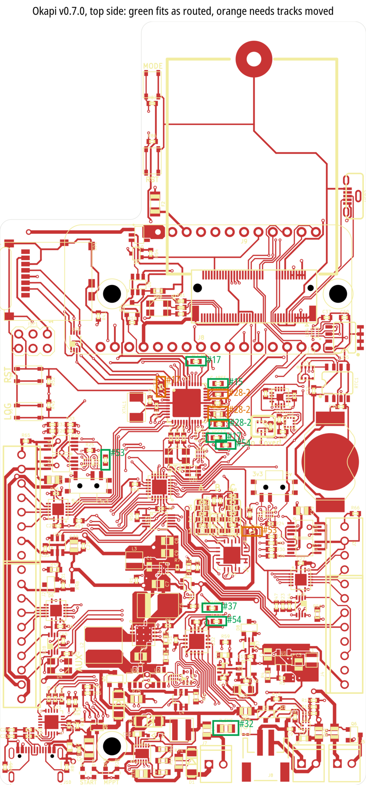
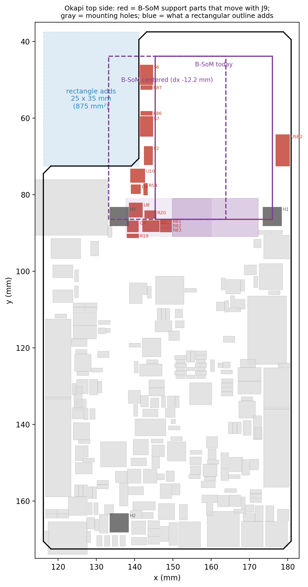

# Okapi v0.7.0: room for the parts seven issues add

Board: Project-Okapi `Hardware/KiCAD-10import/Okapi.kicad_pcb` at cdb1a9f (2026-11-12), 64.75 x 135 mm. Top side only: Okapi is single-sided. Placement only: nothing here is routed, and Andy does the layout. The second half asks the v0.8.0 question: a rectangular outline (#69), and the M.2 socket J9 moved toward the interior.

## Result

13 parts from #15, #17, #28 (item 2), #32, #37, #53 and #54. Every one has a place on the top side, and KiCad's DRC on a scratch board with all 13 reports no courtyard overlap. Nine fit as routed today; four need tracks moved. The plan is `tools/okapi-room07/placed_mix_F.json`.

| Issue | Part | Package | Where | Distance to its target | Fits as routed |
|---|---|---|---|---|---|
| #17 | 100 nF, IC1 VCC 5 / GND 6 | 0402 | (144.60, 102.10) | 2.63 mm | no |
| #17 | 100 nF, IC1 VCC 17 / GND 18 | 0402 | (154.40, 111.10) | 5.39 mm | yes |
| #17 | 100 nF, IC1 VCC 38 / GND 39 | 0402 | (150.80, 97.60) | 3.49 mm | yes |
| #15 | 100 nF, AREF (29) to GND (28) | 0402 | (154.70, 101.50) | 3.22 mm | yes |
| #28-2 | ferrite, 3V3_CORE to AVCC (27) | 0603 (stand-in) | (154.70, 106.90) | 0.45 mm | no |
| #28-2 | 100 nF at AVCC | 0402 | (154.90, 108.70) | 3.49 mm | yes |
| #28-2 | 10 nF at AVCC | 0402 | (154.70, 103.40) | 2.87 mm | no |
| #32 | 50 mΩ sense resistor, L4 output to V_LI | 0805 | (156.10, 162.50) | 7.86 mm | yes |
| #37 | 100 kΩ, SLOW to 3V3_CORE | 0402 | (153.67, 141.21) | 0.59 mm from the net | yes |
| #53 | 100 kΩ, S1 common to GND | 0402 | (160.72, 127.74) | 3.73 mm from the net | no |
| #53 | 100 kΩ, S2 common to GND | 0402 | (134.79, 115.05) | 1.91 mm from the net | yes |
| #54 | 100 kΩ, C0 to GND | 0402 | (154.41, 143.56) | 0.95 mm from the net | yes |
| #54 | 100 kΩ, C1 to GND | 0402 | (156.06, 112.36) | 0.74 mm from the net | yes |

"Fits as routed" is KiCad's verdict on the scratch board: no clearance, short or mask-bridge item involving the part. The four that need tracks moved account for every copper item the DRC reports (27 mask bridges, 18 shorts, 14 clearance, 6 hole clearance), and none involves a courtyard.

**A place is not the same as a good place.** The three IC1 decoupling capacitors land 2.6–5.4 mm from their pads. AN2519 asks for each one as close to its VCC/GND pair as possible, and #17's decision (2026-11-08) already says the fix is a reroute of IC1's fanout. The study confirms that: around IC1 there is no free spot beside pads 17 and 18 within 4 mm, even with tracks moved. The sense resistor sits 7.9 mm from L4, on the V_LI path toward R72. That distance carries charge current only, though SENSE and BAT must then reach the resistor's two ends.

## Method and sensitivity

`tools/okapi-room07/` holds the Margay v3.1 tools adapted to Okapi. `occ.py` builds the occupancy grid at 0.1 mm (courtyards with 0.15 mm spacing, through-hole pads on both sides, board-level silkscreen, 0.4 mm edge). `place07.py` searches each part on the top side at 0° and 90°, nearest to its target. Mode `cu` also keeps new pads 0.15 mm clear of every track, via and pad. Mode `crt` keeps them clear of pads only. Mode `mix` tries `cu` first, then `crt`. A pull resistor's target is its net anywhere on the board (`NET:<name>`), because it can hang off any point of the net.

99 of Okapi's 242 top footprints have no courtyard (the Eagle import), so they block their whole drawing. A lenient case gives those parts their pads plus 0.25 mm. Every verdict holds in it, except that S1's pull-down then fits 0.63 mm from its net (`runs_lenient.txt`).

Reproduce: copy `Okapi.kicad_pcb` from cdb1a9f beside the scripts, then run `PARTS=parts.json python3 place07.py mix F` and `python3 build.py placed_mix_F.json <scratch>/Okapi.kicad_pcb`. Run DRC with the project's `.kicad_pro` and `.kicad_dru` beside it. The unchanged board reports no violation in that setup.

## v0.8.0: a rectangle, and J9 toward the interior

**The rectangle (#69).** Filling the notch at x 116.13–141.13, y 37.50–72.50 adds 25 x 35 mm, or 875 mm². That is 11 % more board (7,863 mm² to 8,738 mm², with the 2 mm corner radii). The area is one free block beside the B-SoM tab, with nothing to move.

**Moving J9 left.** The B-SoM's card outline (J9's F.Fab) spans x 145.39–176.02 and y 43.83–86.46, and its socket pads reach y 90.90. Under the card there are no parts today, only copper. A shift takes the card's support circuitry with it, which `m2shift.py` counts:

| Shift | Card x | Top parts it lands on |
|---|---|---|
| 0 (today) | 145.39–176.02 | 3: H1, R20, R81 (the card's corner already reaches over them) |
| −3 mm | 142.39–173.02 | 11 |
| −5 mm | 140.39–171.02 | 14 |
| −7 mm | 138.39–169.02 | 15, including H3 |
| −12.2 mm (centered) | 133.19–163.82 | 17 |
| −15 mm and beyond | 130.39 and less | 18–19, adding SD1 |

The parts it lands on are J9's own block:
- S6 and S7 (MODE, RST) with R86 and R87;
- F2;
- U10 and U8 (the TPS22917 switch and the TPL5111 timer) with Q3, Q4, R19, R20 and R54;
- D7 and R81–R83.

Moving J9 therefore means moving that block and mounting hole H3 with it, and rerouting J9's bus to IC1 and the expander. It adds no area: a centered card leaves two strips about 17 mm wide, one on each side, in place of the one 25 x 35 mm block the rectangle gives beside a card that stays put.

Three facts bear on the choice, and the study does not settle them:
1. USB2 (N12, vertical USB-C) stays beside J9 at the right edge. #68 asks for a wider right edge for a horizontal USB2, which N12 superseded.
2. The mounting holes form a 40 x 80 mm pattern with one corner missing: H3 (135.94, 85.65), H1 (175.94, 85.65) and H2 (135.94, 165.65), and none at (175.94, 165.65). A centered card at −7 mm or more lands on H3.
3. The fit in the PolyCase WH-16-03 with Andy's plate, which #69 lists as its first check.

Recommendation (a proposal): fill the notch and leave J9 where it is, unless a reason other than area favors the interior, such as protecting the card at the edge or the antenna leads' reach. If it moves, it moves as a block with H3, in the v0.8.0 re-layout.
